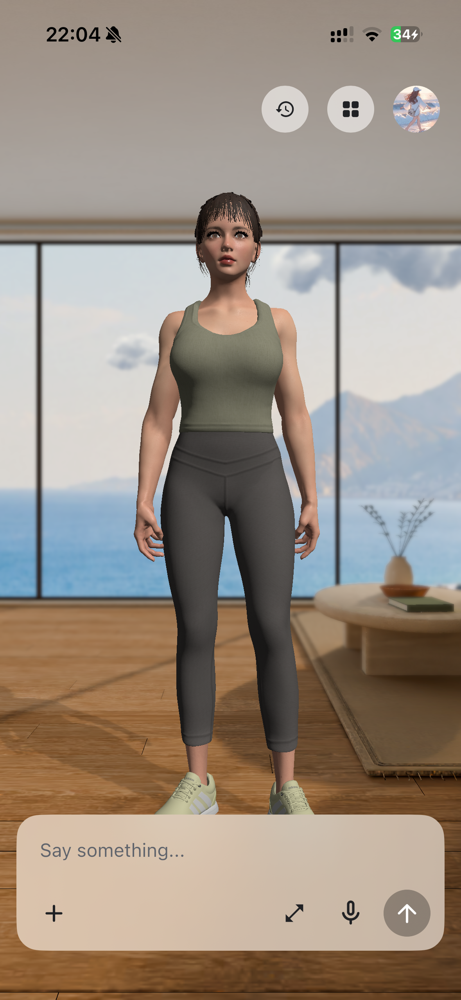
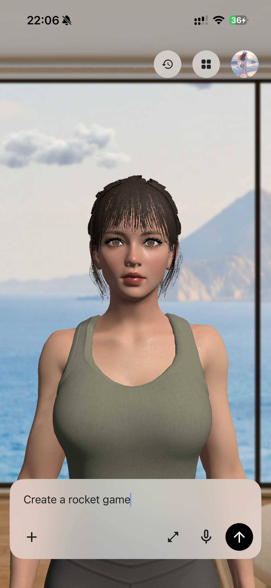
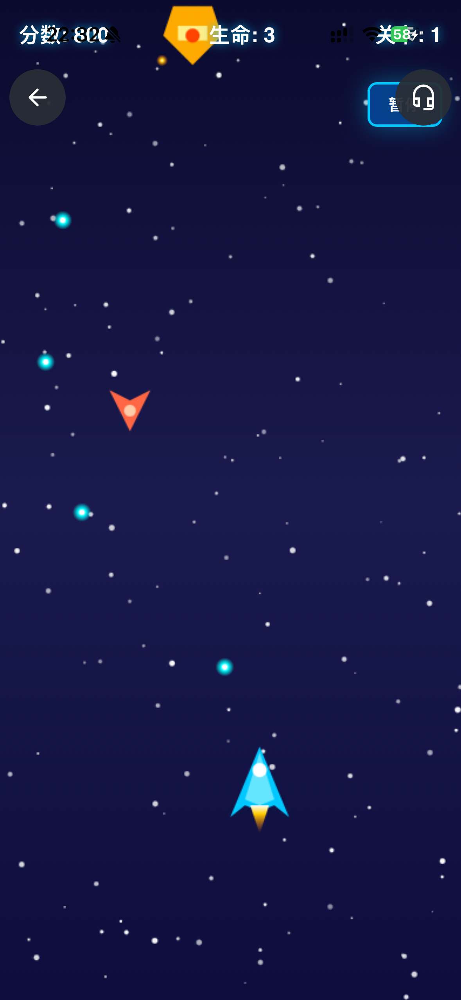
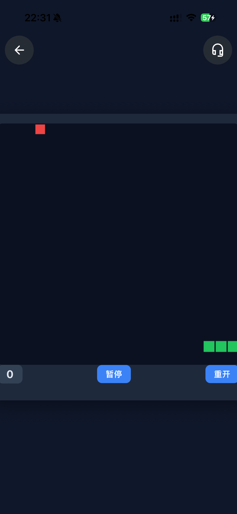
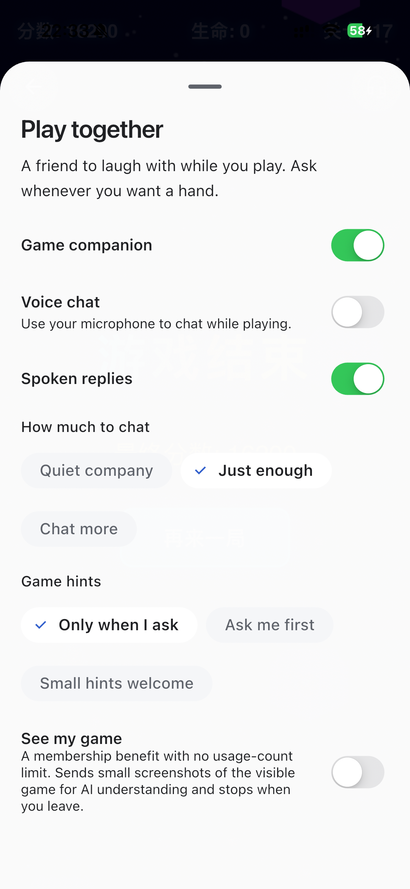
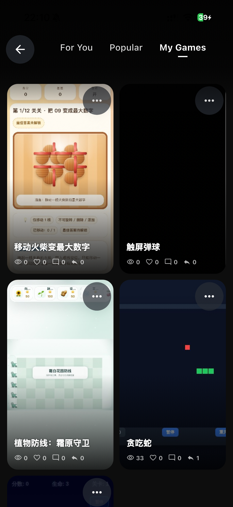

<div align="center">


**Your companion workspace. Local by default.**

Local login · On-device data · System speech · Offline games and applets

[简体中文](README.zh-CN.md) · [Get started](docs/getting-started.md) · [Offline architecture](docs/offline-edition.md) · [Contribute](CONTRIBUTING.md)

</div>

## Original interface, local operation

**open-maaso keeps the original Maaso application, routes, page layouts and interactions.** Home, conversation, games, applets, Play together, Store, workshop, profile, memory and settings use their original pages. A free Pixiv VRM replaces the default character, and the original Settings page exposes model/API-key configuration.

Local login and storage need no Maaso backend. Local adapters supply the existing account, profile, work, catalog and skill services. Conversations and memory retain the original account-scoped Sembast persistence.

| Test account | Value |
| --- | --- |
| Username | `test` |
| Password | `test123456` |

The original login fields are prefilled. This demonstration identity is not a device-encryption mechanism.

## Product capabilities

| Experience | Implementation |
| --- | --- |
| Home and conversation | Original pages, HomeController and serialized AgentRuntime turns |
| Character | Free Pixiv VRM through the existing UnityAvatarRuntime |
| Model configuration | Original Settings panel, 12 providers and secure key storage |
| Voice | Installed system TTS; no cloud TTS or automatic model downloads |
| Games and applets | Original feeds, creation entry, player and companion controls; local works |
| Store and workshop | Original pages with local catalogs, prompt skills and work records |
| Profile and memory | Existing profile, memory and account-scoped data services |
| Hardware | Original BLE applet and shared device transport |
| Membership | Original Free/unavailable-purchase state; no simulated payments |

Without an enabled model, the app provides local setup guidance. A large offline LLM is not bundled; optional model calls need a reachable configured endpoint. Cloud operations without a local implementation return an explicit unavailable result. See the [local migration boundaries](docs/offline-edition.md).

## Bring your own model

In **Settings → Model**, select OpenAI, Anthropic Claude, Google Gemini, DeepSeek, Qwen, Doubao, Kimi/Moonshot, Zhipu GLM, SiliconFlow, Groq, Ollama or a custom OpenAI-compatible endpoint. Review the endpoint and model, enter your key and enable calls. Saving does not run an automatic health probe.

Keys stay in platform secure storage, outside chat, works and Git. Remote endpoints require HTTPS; loopback HTTP supports a model service on the same device. On a phone, `127.0.0.1` means that phone. Model availability depends on your provider account.

## Quick start

Recorded toolchain: **Flutter 3.47.2 / Dart 3.13.2**, Unity **6000.5.2f1** for the native character. Installing development dependencies may need internet access.

```bash
git clone https://github.com/RomanAgent/open-maaso.git
cd open-maaso
flutter pub get
flutter test test/local_test_auth_client_test.dart test/local_original_backend_test.dart \
  test/local_skill_marketplace_test.dart test/original_ui_local_catalog_test.dart \
  test/local_edition_model_integration_test.dart
```

Prepare the Unity export and signing in [Getting started](docs/getting-started.md) and [Native packaging](docs/offline-platforms.md), then use `flutter run -d <device-id>`. The default entry uses **the original `MaasoApp`**, with `MAASO_OFFLINE_EDITION=true` selecting local service adapters.

## Maaso reference screens — November 1, 2026

These real iPhone screenshots show the earlier Maaso reference app, including its original character, room and game controls. They are historical product examples, **not acceptance screenshots of the new offline edition**. The offline avatar uses the separately documented free Pixiv model.

<table>
  <tr>
    <td align="center" width="50%"><strong>Your Agent, at home</strong><br/><a href="docs/media/showcase/home.png"></a><br/><sub>Conversation and embodied presence in one space.</sub></td>
    <td align="center" width="50%"><strong>Start with an idea</strong><br/><a href="docs/media/showcase/game-request.png"></a><br/><sub>Describe the game you want to create.</sub></td>
  </tr>
  <tr>
    <td align="center" width="50%"><strong>Arcade shooter</strong><br/><a href="docs/media/showcase/space-shooter.png"></a><br/><sub>A real saved game, running in the player.</sub></td>
    <td align="center" width="50%"><strong>Snake</strong><br/><a href="docs/media/showcase/gameplay.png"></a><br/><sub>Play, pause, and restart an existing mini-game.</sub></td>
  </tr>
  <tr>
    <td align="center" width="50%"><strong>Play together</strong><br/><a href="docs/media/showcase/game-companion.png"></a><br/><sub>Tune voice, chat frequency, and game hints.</sub></td>
    <td align="center" width="50%"><strong>Your game library</strong><br/><a href="docs/media/showcase/mini-games.png"></a><br/><sub>Keep your works together and open them again.</sub></td>
  </tr>
</table>

<sub>The creation image shows request input; the shooter and Snake are existing saved games. The companion image shows settings, not a recorded voice or autonomous-play session.</sub>

[Capture notes and asset credits →](docs/media/showcase/README.md)

## Validation and next acceptance gates

Local persistence, provider protocol boundaries, credential separation, speech selection and runtime cancellation have focused automated tests. A test command above is not a claim that every native target or paid model account has been exercised.

Remaining acceptance includes a clean native build with the bundled Unity scene, a signed mobile Release install and debugger-free cold launch, actual device TTS and notification delivery, compatible BLE hardware, live provider compatibility with user-owned keys, and native player network/state checks. Full legacy feature parity is not claimed. The [offline edition document](docs/offline-edition.md) tracks these boundaries; the older [verification record](docs/verification.md) describes the initial source export.

## License and contribution

Project-owned source uses the [MIT license](LICENSE). The bundled Pixiv human avatar uses **VRM Public License 1.0 and its embedded settings**, independently of MIT. Third-party packages and native SDKs retain their own terms, including the BLE package's commercial conditions and FFmpeg's LGPL obligations. Read [THIRD_PARTY_NOTICES.md](THIRD_PARTY_NOTICES.md) before distributing a binary.

Keep credentials and signing material outside Git. Follow [SECURITY.md](SECURITY.md) and [CONTRIBUTING.md](CONTRIBUTING.md), and use [Issues](https://github.com/RomanAgent/open-maaso/issues) for reproducible reports and focused contributions.
