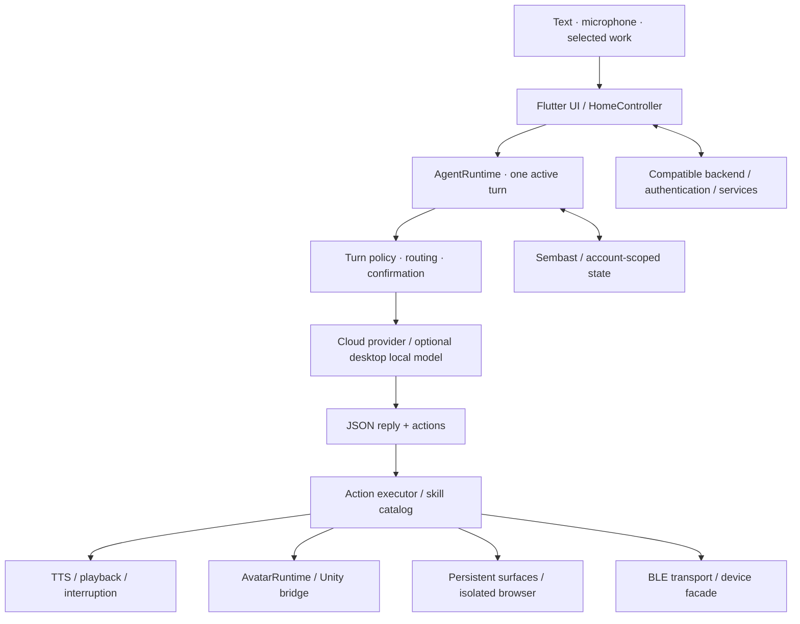

<div align="center">


**An embodied AI workspace, built with Flutter.**

Voice conversations · Avatar runtime · Generated apps · Device skills

[简体中文](README.zh-CN.md) · [Get started](docs/getting-started.md) · [Architecture](docs/architecture.md) · [Contribute](CONTRIBUTING.md)

</div>

## From conversation to something you can use

An agent can do more than return a message. It can speak, respond through an avatar, create an interactive app, and work with a connected device.

**open-maaso** brings these experiences into one application runtime. It is the open client source edition of Maaso: a Flutter codebase for developers exploring embodied assistants, conversational interfaces, and agent-generated software.

> **Release scope:** this repository contains client source and tests. The main application requires a compatible backend for authentication and service APIs. Backend deployment, production credentials, licensed character/room assets, large LLM/ASR/TTS model weights, and generated Unity players are not included. The small Silero VAD model is bundled with its upstream notices. This is a developer source release; a fresh clone is not a complete hosted service or a ready-to-run avatar demo.

## One runtime. Several ways to act.

| Capability | What the code provides | Where to look |
| --- | --- | --- |
| **Conversational agent** | Serialized turns, routing policy, structured actions, and provider integration | [`agent_runtime.dart`](lib/src/features/agent/application/agent_runtime.dart) |
| **Voice interaction** | Microphone capture, playback gating, speech segments, TTS queues, and interruption handling | [`core/services`](lib/src/core/services) |
| **Embodied presence** | A renderer-independent avatar contract and a Unity bridge | [`avatar`](lib/src/features/agent/application/avatar) |
| **Generated software** | Persistent interactive surfaces, browser-based games and applets, and scoped invocation | [`surface`](lib/src/features/agent/application/surface) |
| **Device skills** | Shared BLE transport and device-specific facades | [`skills`](lib/src/features/agent/application/skills) |
| **Local continuity** | Sembast persistence, account-scoped lifecycle, and recovery paths | [`core/services`](lib/src/core/services) |

The interesting part is how these pieces cooperate: speech and avatar state follow the same turn lifecycle; generated works can persist beyond a conversation; device actions pass through native capability and confirmation boundaries.

## Built for agents that do real work

**Structured execution.** Model replies use a JSON envelope with `reply` and `actions`. Parsing, policy, and execution remain separate, so a model response is input to the runtime rather than native authority.

**An open canvas for generated apps.** Web games and applets use ordinary HTML, CSS, and JavaScript. Authored styling, external libraries, and network dependencies are permitted within browser isolation. Saving source does not imply that remote resources are available offline.

**A replaceable embodiment layer.** UI code targets `ActiveAvatarRuntime`; Unity behavior stays behind `AvatarRuntime`. Speech owns mouth movement. The avatar is a runtime participant with lifecycle and bridge contracts.

**Explicit local and cloud choices.** Cloud services are the default. Optional local LLM, ASR, and neural TTS paths are desktop-only and require appropriate models and setup. Bring-your-own-key LLM configuration does not remove the application's backend login requirement.

## Architecture at a glance



[Explore the runtime and extension points →](docs/architecture.md)

## Start with the source

The source environment uses **Flutter 3.47.2 / Dart 3.13.2**. The package declares Dart `^3.11.5`; native dependencies can impose additional toolchain requirements.

```bash
git clone https://github.com/RomanAgent/open-maaso.git
cd open-maaso
flutter pub get

# Exercise the action and turn-policy boundaries without launching the app.
flutter test test/agent_action_protocol_test.dart \
  test/turn_policy_test.dart \
  test/turn_policy_wiring_test.dart
```

To run the application, first prepare your backend, platform tools, and required assets. Configure **your own** service origins:

```bash
flutter run -d <device-id> \
  --dart-define=MAASO_TEST_BASE_URL=https://api-dev.example.com \
  --dart-define=MAASO_PRODUCTION_BASE_URL=https://api.example.com
```

These example domains are placeholders. `--dart-define` values are compiled into the client: use them for public configuration, never server secrets.

**iOS requires a separately generated Unity export before it can build.** macOS Release and Profile builds require an exported Unity sidecar; Debug may omit it only when `MAASO_REQUIRE_UNITY_SIDECAR` is not `1`; without the sidecar, the avatar remains unavailable. Android includes Unity only when a local export is present; that does not make its avatar experience complete without one. See the [setup guide](docs/getting-started.md) before choosing a target.

## Platform and release boundaries

| Area | Current source scope |
| --- | --- |
| Android | Flutter/native host code; conditional Unity integration; SDK, service configuration, and device validation required |
| iOS | Flutter/native host code; Xcode/CocoaPods, signing, and a generated Unity iOS project required |
| macOS | Desktop host and local-model paths; Release/Profile require a Unity sidecar; Debug can omit it with the default build setting |
| Windows / Linux | Desktop host code and opt-in local-model paths; native dependency and renderer readiness require separate validation |
| Web | Browser-specific code paths exist; full application/plugin parity is not established |
| Accounts and cloud services | Compatible backend required; backend implementation and hosted access are outside this release |
| Character and room content | Original licensed assets excluded; supply content you have permission to use and redistribute |

Source presence is not a platform certification. See the [release verification record](docs/verification.md) for the checks actually performed on this export.

## Make it yours

- Add a skill through the existing catalog and shared services.
- Build a generated app or game, then expose a bounded callable interface.
- Connect a device through the centralized BLE transport and its product facade.
- Extend an avatar behavior through the runtime contract.
- Improve a focused protocol, lifecycle, or platform test.

Read [CONTRIBUTING.md](CONTRIBUTING.md) before changing runtime ownership, native authority, or service initialization.

## Roadmap

The next public-release milestones are a reproducible backend integration recipe, redistributable sample avatar/scene assets, clean-clone native build verification, and a simpler onboarding path. These are work to complete, not capabilities promised by this source release.

Ideas and focused contributions are welcome in [Issues](https://github.com/RomanAgent/open-maaso/issues).

## Licensing and security

Project-owned source is offered under the [MIT License](LICENSE). Third-party packages, native SDKs, fonts, model weights, and artwork keep their own terms; the repository license does not relicense them. In particular, the pinned `flutter_blue_plus` dependency has separate commercial licensing requirements, and the FFmpeg dependency has LGPL obligations. See [THIRD_PARTY_NOTICES.md](THIRD_PARTY_NOTICES.md) before redistributing a build.

Credentials, signing material, user data, and private Git history are excluded from this source release. Store your own secrets outside version control and report suspected exposure using [SECURITY.md](SECURITY.md).

<div align="center">

**Give your agent a voice, a presence, and a workspace.**

</div>
