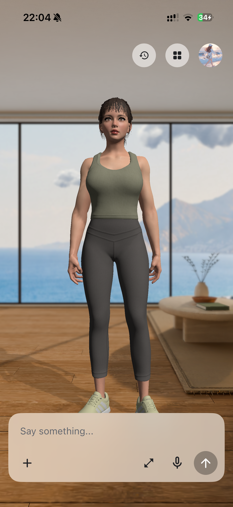
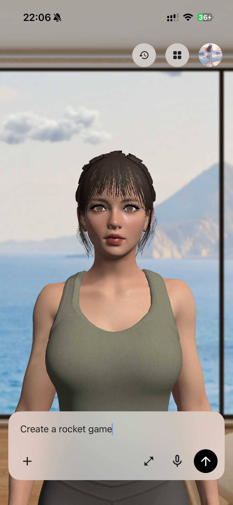
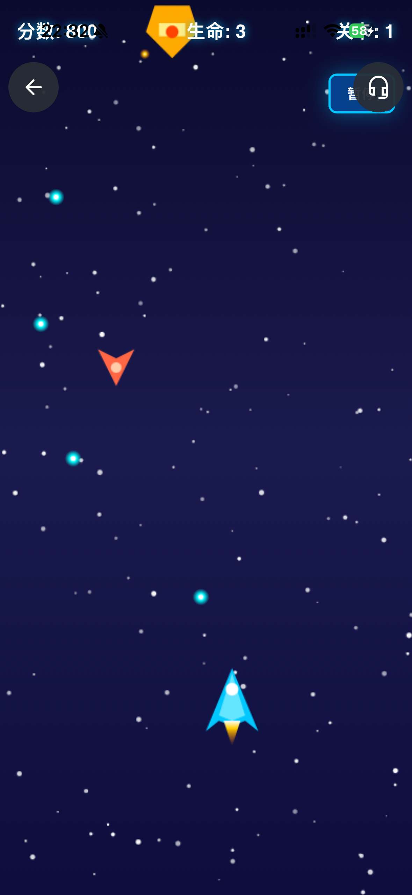
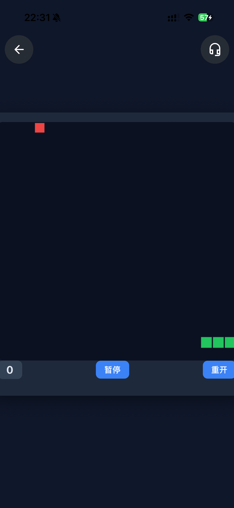
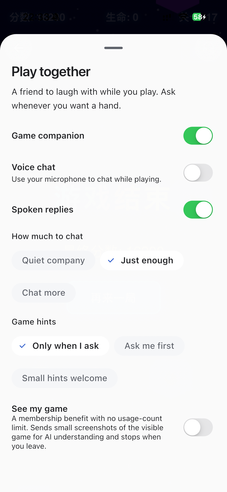
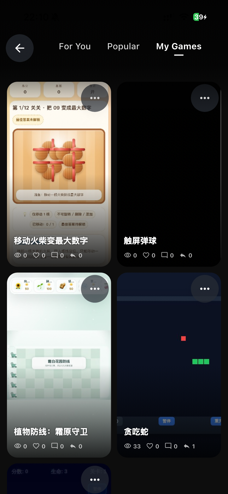
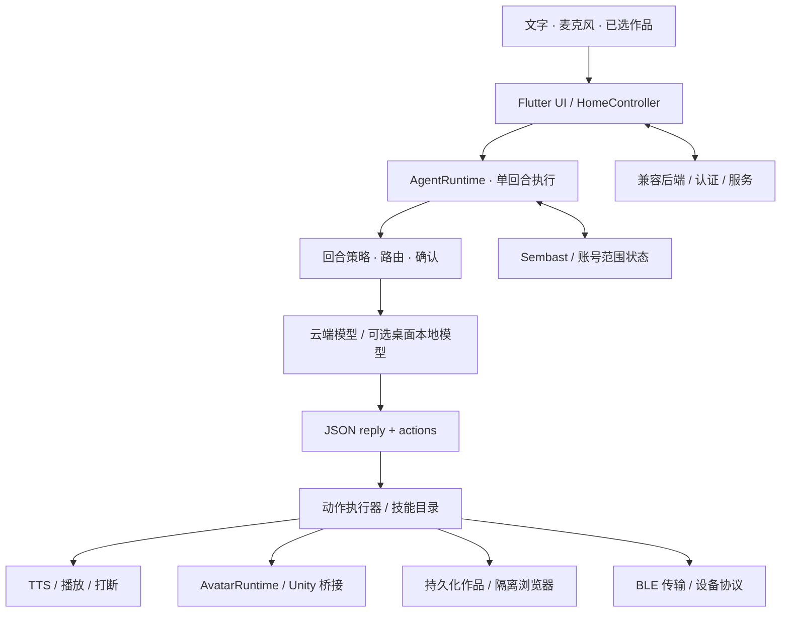

<div align="center">


**用 Flutter 构建具身 AI 工作空间。**

语音对话 · Avatar 运行时 · 生成式应用 · 设备技能

[English](README.md) · [开始开发](docs/getting-started.md) · [架构](docs/architecture.md) · [参与贡献](CONTRIBUTING.md)

</div>

## 看看 Maaso 的实际体验

Home 陪伴、自然语言创作、战机与贪吃蛇，以及游戏内的陪玩控制。

<table>
  <tr>
    <td align="center" width="50%"><strong>Home · 与 Agent 相伴</strong><br/><a href="docs/media/showcase/home.png"></a><br/><sub>在同一个空间中承载对话与角色呈现。</sub></td>
    <td align="center" width="50%"><strong>小游戏创作 · 从一句话开始</strong><br/><a href="docs/media/showcase/game-request.png"></a><br/><sub>通过对话描述想做的小游戏。</sub></td>
  </tr>
  <tr>
    <td align="center" width="50%"><strong>雷霆战机 · 纵版射击</strong><br/><a href="docs/media/showcase/space-shooter.png"></a><br/><sub>真实运行的战机小游戏，展示飞机与弹幕。</sub></td>
    <td align="center" width="50%"><strong>贪吃蛇 · 经典玩法</strong><br/><a href="docs/media/showcase/gameplay.png"></a><br/><sub>在播放器中游玩、暂停与重新开始。</sub></td>
  </tr>
  <tr>
    <td align="center" width="50%"><strong>小游戏陪玩 · Play together</strong><br/><a href="docs/media/showcase/game-companion.png"></a><br/><sub>在游戏内设置语音、聊天频率与提示方式。</sub></td>
    <td align="center" width="50%"><strong>我的小游戏库</strong><br/><a href="docs/media/showcase/mini-games.png"></a><br/><sub>集中查看并重新打开已保存的作品。</sub></td>
  </tr>
</table>

<sub>2026 年 11 月 1 日拍摄于已安装的 Maaso iPhone App。创作图展示请求输入，两款游戏为已有作品；开源客户端的运行前提见配置指南。</sub>

[拍摄说明与素材署名 →](docs/media/showcase/README.md)

## 让对话变成可以使用的东西

Agent 可以不止于回复文字。它可以开口说话，通过角色回应，生成可交互的应用，也可以连接身边的设备。

**open-maaso** 把这些体验放进同一个应用运行时。它是 Maaso 的开源客户端源码版本，面向希望研究具身助手、对话交互和 Agent 生成软件的开发者。

> **当前发布范围：** 本仓库提供客户端源码与测试。主应用需要兼容后端提供账号认证和服务 API；不包含后端部署、生产凭据、受限角色与房间素材、大型 LLM/ASR/TTS 模型权重或生成后的 Unity 播放器；小型 Silero VAD 模型随上游声明一同保留。这是开发者源码发布，克隆仓库并不等于获得完整在线服务或可直接运行的角色演示。

## 一个运行时，多种行动方式

| 能力 | 代码提供的基础 | 源码入口 |
| --- | --- | --- |
| **对话 Agent** | 串行回合、路由策略、结构化动作与模型服务接入 | [`agent_runtime.dart`](lib/src/features/agent/application/agent_runtime.dart) |
| **语音交互** | 麦克风采集、播放门控、语音片段、TTS 队列和打断处理 | [`core/services`](lib/src/core/services) |
| **具身呈现** | 与渲染器解耦的 Avatar 合约，以及 Unity 桥接 | [`avatar`](lib/src/features/agent/application/avatar) |
| **生成式软件** | 可持久化交互界面、浏览器小游戏与小应用、受限调用 | [`surface`](lib/src/features/agent/application/surface) |
| **设备技能** | 统一 BLE 传输与设备协议封装 | [`skills`](lib/src/features/agent/application/skills) |
| **本地连续性** | Sembast 存储、账号生命周期与恢复流程 | [`core/services`](lib/src/core/services) |

这些模块围绕同一条交互链协作：语音与角色状态跟随回合生命周期；生成作品可以在对话结束后继续保留；设备操作通过原生能力边界和确认机制执行。

## 为能够实际行动的 Agent 而设计

**结构化执行。** 模型通过包含 `reply` 和 `actions` 的 JSON 合约输出。解析、策略和执行分层处理，模型回复进入运行时校验，不直接获得原生权限。

**开放的生成式应用画布。** Web 游戏和小应用使用普通 HTML、CSS 与 JavaScript，可采用自己的风格、外部库和网络资源，并在浏览器隔离边界内运行。保存源码不等于已缓存所有远程依赖。

**可扩展的具身层。** UI 面向 `ActiveAvatarRuntime`，Unity 行为收敛在 `AvatarRuntime` 后。TTS 负责口型，角色拥有明确的生命周期与桥接合约。

**明确的本地与云端选择。** 默认使用云服务。可选本地 LLM、ASR 和神经 TTS 仅限桌面平台，并需要相应模型与配置。自带 LLM API Key 不会绕过主应用的后端登录要求。

## 架构速览



[查看运行时与扩展边界 →](docs/architecture.md)

## 从源码开始

源码环境使用 **Flutter 3.47.2 / Dart 3.13.2**。项目声明 Dart `^3.11.5`，原生依赖可能有额外工具链要求。

```bash
git clone https://github.com/RomanAgent/open-maaso.git
cd open-maaso
flutter pub get

# 验证动作协议与回合策略，无需启动应用。
flutter test test/agent_action_protocol_test.dart \
  test/turn_policy_test.dart \
  test/turn_policy_wiring_test.dart
```

运行主应用前，需要准备自己的兼容后端、平台工具和必要素材，并配置服务地址：

```bash
flutter run -d <device-id> \
  --dart-define=MAASO_TEST_BASE_URL=https://api-dev.example.com \
  --dart-define=MAASO_PRODUCTION_BASE_URL=https://api.example.com
```

示例域名是占位符。`--dart-define` 的内容会编译进客户端，只应存放公开配置，不能用于保存服务端密钥。

**iOS 需要先生成独立 Unity 导出工程才能构建。** macOS Release 与 Profile 构建必须提供 Unity sidecar；Debug 在未设置 `MAASO_REQUIRE_UNITY_SIDECAR=1` 时允许缺少 sidecar，此时角色不可用。Android 仅在本地存在导出工程时接入 Unity；没有导出工程也不代表拥有完整角色体验。选择目标平台前，请先阅读[配置指南](docs/getting-started.md)。

## 平台与发布边界

| 范围 | 当前源码状态 |
| --- | --- |
| Android | 包含 Flutter 和原生宿主代码，Unity 接入有条件启用；仍需 SDK、服务配置与设备验证 |
| iOS | 包含 Flutter 和原生宿主代码；需要 Xcode、CocoaPods、签名与生成后的 Unity iOS 工程 |
| macOS | 包含桌面宿主和本地模型路径；Release/Profile 必须提供 Unity sidecar，Debug 在默认构建设置下允许缺少它 |
| Windows / Linux | 包含桌面宿主和可选本地模型路径；原生依赖及渲染器需分别验证 |
| Web | 存在浏览器专用实现；尚未建立完整应用与插件的能力对齐验收 |
| 账号与云服务 | 需要兼容后端；后端实现与托管服务不在此次发布范围内 |
| 角色与场景 | 原始受限素材已排除；需自行提供具有使用及再分发权利的内容 |

有平台代码不等于已完成平台验收。实际完成的检查以本次导出的[验证记录](docs/verification.md)为准。

## 从一个清晰的扩展点开始

- 通过现有技能目录和共享服务添加技能。
- 制作生成式应用或游戏，并声明有界的可调用接口。
- 通过统一 BLE 传输与设备封装接入硬件。
- 沿 Avatar 运行时合约扩展角色行为。
- 为协议、生命周期或平台边界补充聚焦测试。

修改运行时所有权、原生权限或服务初始化前，请阅读 [CONTRIBUTING.md](CONTRIBUTING.md)。

## 接下来的公开版本里程碑

可复现的后端接入说明、可再分发的示例角色与场景、干净克隆后的原生构建验证，以及更简单的首次配置流程。这些仍是待完成的工作，不作为此次源码发布已经具备的能力宣传。

欢迎通过 [Issues](https://github.com/RomanAgent/open-maaso/issues) 提出具体问题和贡献方向。

## 许可证与安全

项目自有源码采用 [MIT 许可证](LICENSE)。第三方包、原生 SDK、字体、模型权重和素材保留各自条款，不会因仓库使用 MIT 而自动变更授权。特别是锁定的 `flutter_blue_plus` 具有独立商业授权要求，FFmpeg 依赖具有 LGPL 义务。分发构建产物前，请先查看 [THIRD_PARTY_NOTICES.md](THIRD_PARTY_NOTICES.md)。

本次源码发布排除了凭据、签名材料、用户数据及原项目 Git 历史。请在版本控制之外保存自己的密钥；发现疑似泄露时按 [SECURITY.md](SECURITY.md) 处理。

<div align="center">

**让 Agent 拥有声音、形象与工作空间。**

</div>
