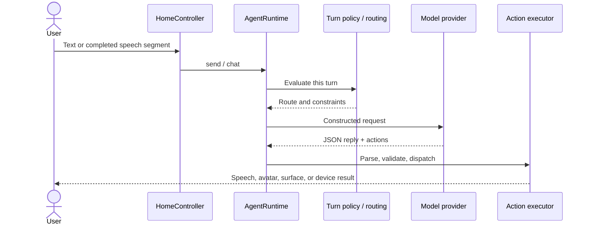

# Architecture

> **Architecture reference.** The default entry now retains these original Maaso pages and services with local-edition adapters. See [offline-edition.md](offline-edition.md) for active boundaries; cloud requirements below apply to the optional legacy configuration.

open-maaso is a Flutter client built around one serialized agent turn. This document describes the retained client architecture; it does not imply that the backend or licensed rendering content is distributed with this repository.

## The main turn

`HomeController.send()` enters `AgentRuntime.chat()`. Routing and turn policy select an allowed path, model output is parsed as a structured envelope, and the action executor dispatches validated actions through the skill and capability layers.



A model response has the form:

```json
{"reply":"Let's work on it.","actions":[]}
```

Native actions remain subject to runtime validation, ownership, policy, and confirmation. Generated app content cannot grant itself account, device, or native-write authority.

## Ownership and persistence

Riverpod owns reactive application state. `appServices` supplies shared runtime dependencies. Initialization in `lib/main.dart` is an ordered dependency graph: prompt, memory, model, speech, avatar, and device services must be available at the appropriate lifecycle stage.

Sembast provides embedded persistence. Account mount and retirement fence account-scoped runtime resources. A runtime allows one chat turn at a time; concurrent model calls must not race turn state, the speech queue, or avatar state.

## Presentation and generated works

The host application follows its shared Flutter design system. Generated games and applets have their own authored styles.

`SurfaceProject` describes generated work, and persistent surfaces use `AgentWidget(kind: "surface")`. Ordinary web works use browser HTML/CSS/JavaScript, including external dependencies. Browser isolation and native capability boundaries are separate concerns: neither authored metadata nor access to a DOM creates native permission. Remote dependencies can make a saved work connectivity-dependent.

## Embodiment

UI uses `ActiveAvatarRuntime`, which delegates through `AvatarRuntime`. `UnityAvatarRuntime` implements the Unity integration. Native channels carry lifecycle and behavior contracts; TTS owns mouth movement.

The original paid characters and purchased motions remain excluded. The public
scene retains the Maaso-authored Coastal V4 room with reviewed CC0 texture
inputs, original Home/login artwork, camera, lighting and depth of field. The
character is the reviewed Pixiv VRM with a complete imported Humanoid baseline.
The original Unity runtime and login controller remain the presentation path.
Generated Unity players/native exports remain build outputs outside Git.
See [native packaging](offline-platforms.md) for the required local export and
[asset policy](media/asset-policy.md) for source/provenance boundaries.

## Speech and local models

Speech consumers use the recognition stream and completed VAD speech segments. TTS keeps its generation and queue semantics across pause, resume, playback gating, and interruption.

Cloud models and cloud TTS are the default. Optional local LLM, ASR, and neural TTS are desktop-only paths. The application's platform policy, rather than older dependency comments, determines whether local loading is permitted. Desktop ASR uses user-imported models. Large LLM/ASR/TTS weights are excluded from the release. The small Silero VAD model remains bundled with its upstream license notices; it detects speech activity and is not an ASR model.

## Services and hardware

A compatible backend is required for the authenticated main experience and retained service APIs. Direct-provider LLM configuration is a separate model path; it does not replace account authentication or the rest of the backend.

BLE transport is centralized in `BleTransportService`. Product protocols live in device facades, and skills reuse those instances. Do not introduce another scan/connect/write stack in a page or skill.

## Useful entry points

| Concern | Location |
| --- | --- |
| Dependency graph | `lib/main.dart` |
| Routing | `lib/src/app/routing/router_config.dart` |
| Home turn entry | `lib/src/features/home/application/home_controller.dart` |
| Agent turn | `lib/src/features/agent/application/agent_runtime.dart` |
| Turn policy | `lib/src/features/agent/application/turn_policy.dart` |
| Action envelope and executor | `lib/src/features/agent/application/action/` |
| Skills | `lib/src/features/agent/application/skills/` |
| Skill registration | `lib/src/features/agent/application/skill_catalog.dart` |
| Avatar contracts and implementation | `lib/src/features/agent/application/avatar/` |
| Generated works | `lib/src/features/agent/application/surface/` |
| Embedded database | `lib/src/core/services/db_service.dart` |

## Extension rules

Keep cloud/local selection in the runtime, deterministic turn decisions in turn policy, and fast reflex work in the existing reflex/router services. Add a skill through the catalog, return machine-readable results, and reuse shared services. Extend avatar contracts before adding renderer-specific behavior. Every navigable destination belongs in the route catalog; callable page actions need declared, bounded interfaces and confirmation for consequential effects.

Test the boundary you change. Do not treat passing protocol unit tests as proof of device, rendering, speech, or clean-clone build acceptance.

See the [release verification record](verification.md) for tested boundaries and unverified platform integration.
